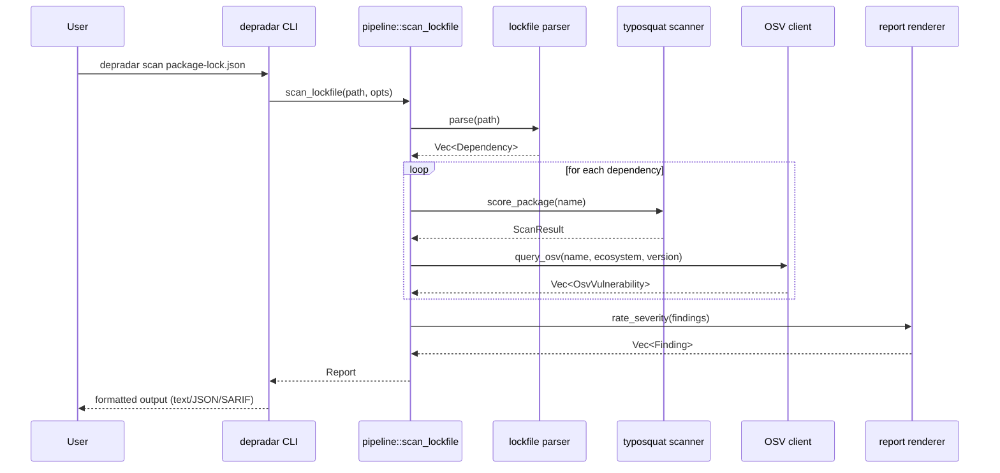
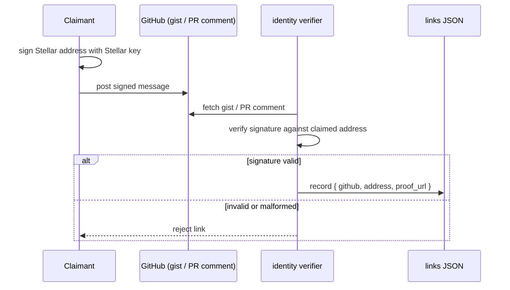
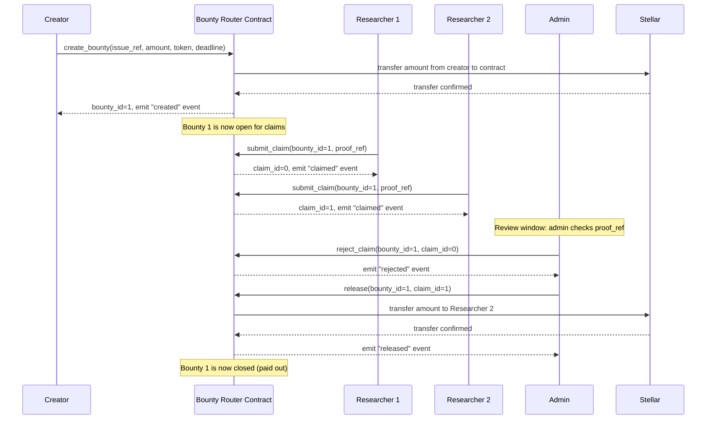
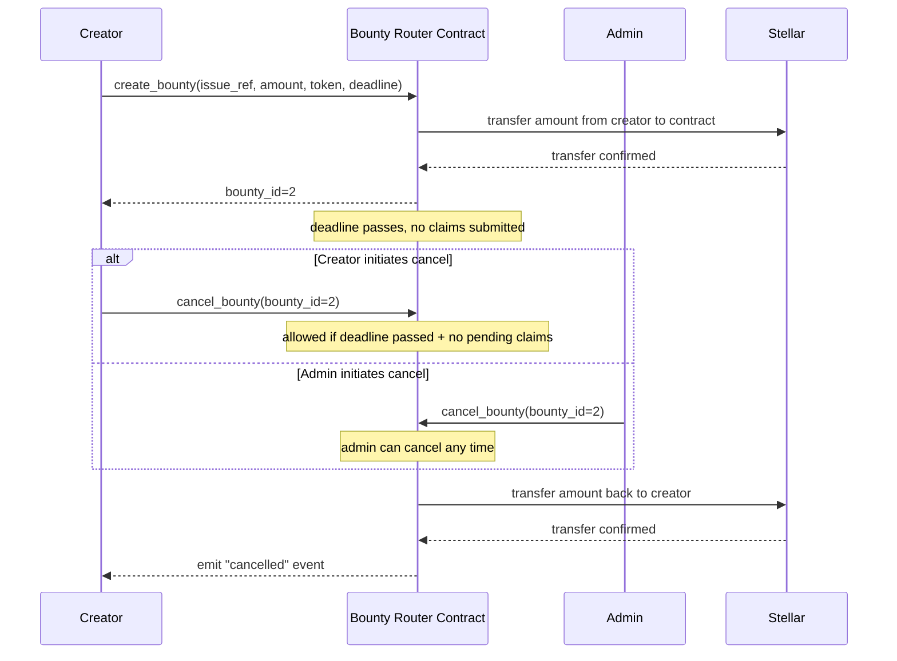
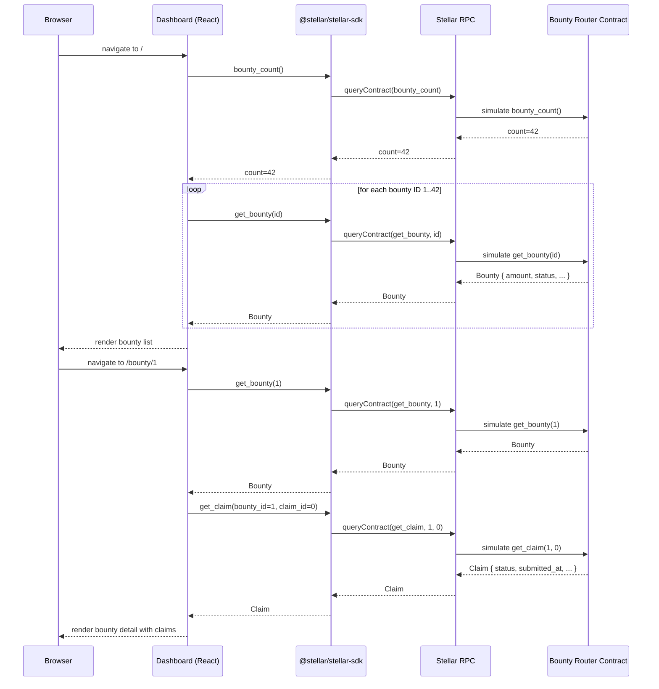

# Architecture

This document describes how DepRadar components fit together and how data moves through the system.

## System Overview

DepRadar is built around three independent layers:

1. **Off-chain detection** — crawlers discover packages, scanners evaluate them
2. **On-chain registry** — the Bounty Router contract locks funds and pays out
3. **Read-only views** — the dashboard and CLI display contract state

The detection layer feeds findings to the contract. The contract is the trust boundary: it locks funds, records claims, and decides payouts. The dashboard reads contract state without authority.

## Module Responsibilities

### Crawler (`src/crawler/`)

The crawler discovers new packages and versions from public registries. Each registry has its own crawler implementation (`npm.rs`, `pypi.rs`, `crates.rs`) that polls for changes, emits `PackageEvent`s (new package or new version), and persists a checkpoint so it can resume after a restart. The npm crawler reads the CouchDB `_changes` feed; PyPI uses RSS; crates.io queries the sparse index. All crawlers share a rate-limited HTTP client (`src/net.rs`) and write checkpoints to disk (`checkpoint.rs`).

### Scanner (`src/typosquat/`, `src/cve/`, `src/behavioral/`, `src/license/`)

The scanner evaluates packages against four detection classes:

- **Typosquat** (`typosquat/`) — edit-distance, homoglyph (lookalike characters), keyboard typos, combosquat (popular name + bait suffix), and scope confusion. Uses a BK-tree index over the top-1000 packages from npm, PyPI and crates.io.
- **CVE matching** (`cve/`) — queries [osv.dev](https://osv.dev) for known vulnerabilities in a pinned package version.
- **Behavioral** (`behavioral/`) — analyzes unpacked package contents for install-time scripts, shipped native binaries, and risky changes between versions.
- **License** (`license/`) — fetches license metadata from registries and flags licenses outside a configurable allowlist.

The pipeline (`pipeline.rs`) ties them together: parse a lockfile, run all checks, rate severity, and render a report (text, JSON, or SARIF).

### Bounty Router (`contracts/deprader_router/`)

The Soroban smart contract on Stellar that locks funds, records claims, and pays out. It's the trust boundary between finders and funders. A bounty is created with `create_bounty(creator, issue_ref, amount, token, deadline)`; researchers submit claims with `submit_claim(bounty_id, claimant, proof_ref)`. The admin reviews claims (`reject_claim` or `release`). Funds are locked on creation and paid on release; unclaimed bounties can be cancelled after the deadline. Every state change emits an event (`created`, `claimed`, `rejected`, `released`, `cancelled`).

### Dashboard (`frontend/`)

A React app that reads the contract's public state (`bounty_count`, `get_bounty`, `get_claim`) via Stellar RPC. It lists every bounty, shows claim details, and displays live stats (total paid out, bounties funded). The dashboard holds no keys and submits no transactions — it's a pure read-only view.

### CLI (`src/bin/depradar.rs`)

A command-line interface for scanning lockfiles (`depradar scan <lockfile>`), explaining advisories (`depradar explain <CVE-id>`), and generating shell completions. The CLI calls `pipeline::scan_lockfile` and respects a `depradar.toml` config file.

### Client (`client/`)

A minimal Node/TypeScript wrapper around the contract's read methods, used for scripting and testing. It calls `get_bounty` and `get_claim` via `@stellar/stellar-sdk` and prints the result.

### Identity Verifier (`src/identity/`)

Links GitHub identities to Stellar addresses so that a claim's `proof_ref` (a GitHub PR) can be tied to the address that receives the payout. The claimant signs their Stellar address with their Stellar key and posts the signature in a gist or PR comment; the verifier (`src/identity/`) checks the signature against the claimed address. Verified links are stored off-chain as JSON. See [identity-verification.md](identity-verification.md) for the trust model and the exact verification steps.

## Sequence Diagrams

### Scan → Finding

A lockfile scan runs all detection checks and produces a report:



The CLI parses options, calls the pipeline, and formats the result. The pipeline parses the lockfile into dependencies, runs the typosquat and CVE checks in parallel, rates severity, and returns a report. The report is rendered as text, JSON, or SARIF depending on `--format`.

### GitHub → Stellar Identity Verification

Before a claim is reviewed, the claimant's GitHub identity is linked to a Stellar address:



The verifier only trusts a link once the signature checks out against the claimed Stellar address. The stored JSON is the off-chain source of truth for which GitHub account controls which address.

### Create Bounty → Claim → Review → Release

A complete bounty lifecycle from creation to payout:



Multiple researchers can claim the same bounty. The admin reviews each claim and either rejects it (bounty stays open) or releases it (bounty closes, funds move to the claimant). A junk claim submitted first can't block the real finder.

### Cancel Bounty (Refund)

If no valid claims arrive, the creator gets their funds back:



The admin can cancel any time. The creator can cancel once the deadline has passed with no pending claims, or after a 7-day review window. Funds are never locked forever.

### Dashboard Reads

The dashboard displays bounties and claims by reading contract state:



All contract reads are simulated RPC calls (`queryContract`) — no transactions, no wallet, no auth. The dashboard fetches `bounty_count`, iterates to fetch each bounty, and on the detail page fetches each claim. Results are cached in React state.

## Data Flow

```
Registries (npm, PyPI, crates.io)
    ↓
Crawler (polls for new packages/versions)
    ↓
Scanner (typosquat, CVE, behavioral, license)
    ↓
Finding (severity-rated)
    ↓
Bounty Router (create_bounty locks funds)
    ↓
Researcher (submit_claim with proof_ref)
    ↓
Identity verifier (GitHub ↔ Stellar link, stored off-chain)
    ↓
Admin (reject_claim or release)
    ↓
Stellar (transfer funds to claimant)
    ↓
Dashboard (displays bounty + claims)
```

The scanner runs independently of the contract — a finding doesn't automatically create a bounty. The contract is called explicitly (by a funder or by automation) to lock funds against a finding. The dashboard displays the contract's state but has no authority to create, claim, or release bounties.

## Deployment

The Bounty Router is deployed on Stellar testnet:

- **Contract ID**: [`CCPRQANY467KKE4ROKCNW6TH3LY3EPVFRXIXJ5V4VCYHLJKWZPOZYQJQ`](https://stellar.expert/explorer/testnet/contract/CCPRQANY467KKE4ROKCNW6TH3LY3EPVFRXIXJ5V4VCYHLJKWZPOZYQJQ)
- **Network**: Stellar testnet
- **Admin**: set once at `initialize(admin)` time, rotatable via two-step `propose_admin` / `accept_admin`

The dashboard is deployed on GitHub Pages. The CLI is distributed as prebuilt binaries for Linux, macOS, and Windows.

See [DEPLOYMENT.md](../DEPLOYMENT.md) for the full deployment procedure (build wasm, deploy with `stellar contract deploy`, `initialize --admin`, update contract ID in code).
